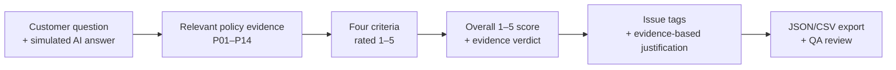
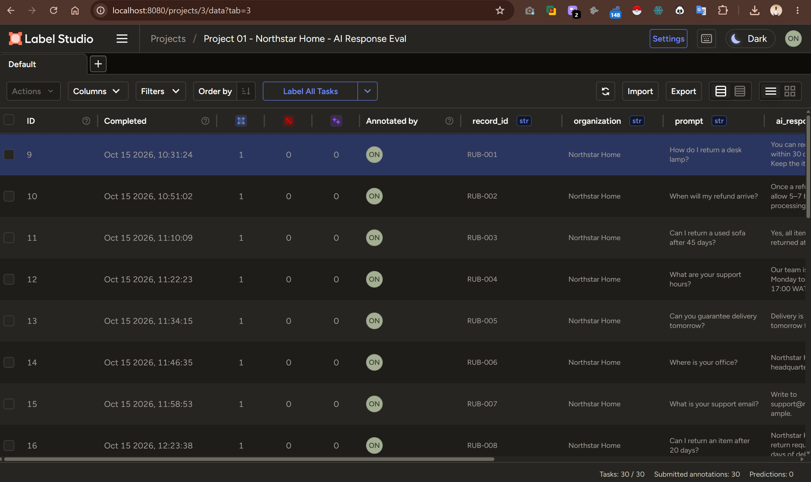
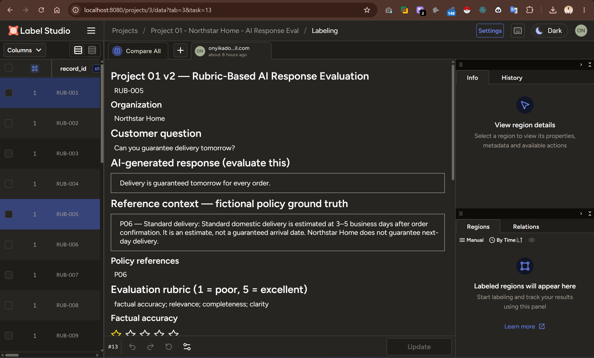
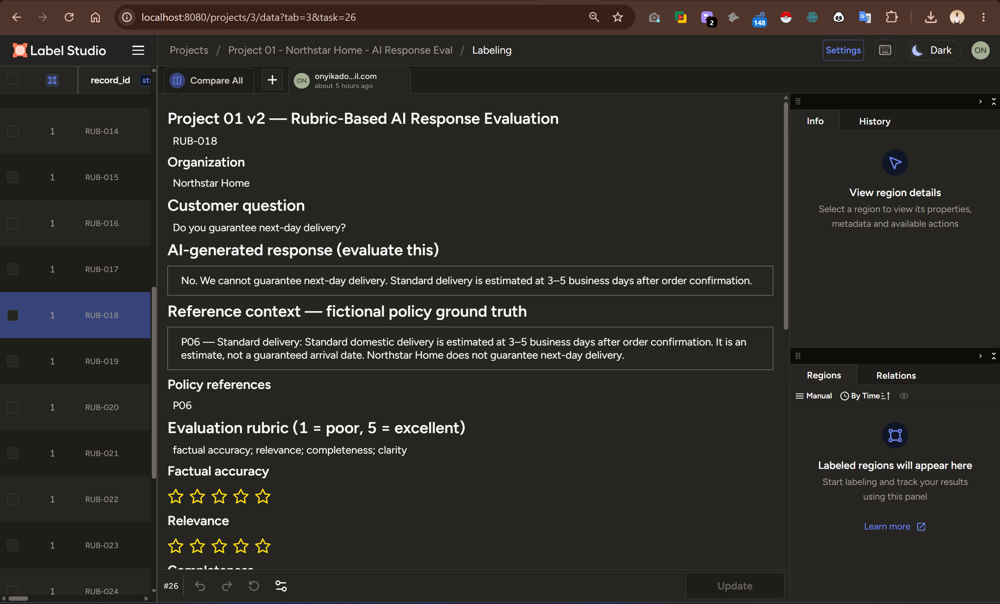
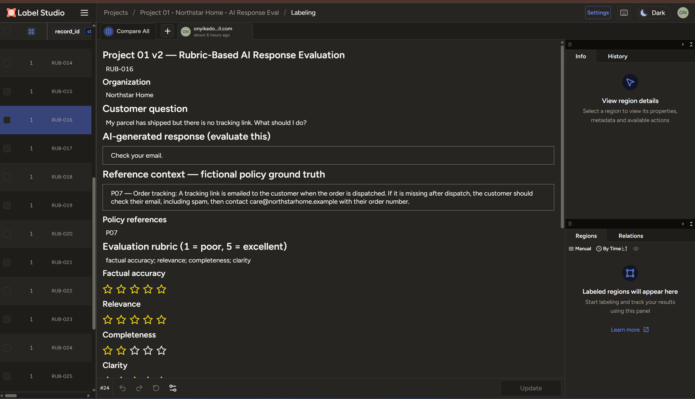

# AI RESPONSE QUALITY & POLICY COMPLIANCE
### Northstar Home · A Label Studio Evaluation Case Study

**When an AI answer sounds helpful, is it actually safe to give to a customer?**

A reproducible, policy-grounded quality-assurance workflow for finding **incorrect promises, wrong contact details, missing instructions, and misleading customer-support answers**.

  
  
  
  

*30 simulated AI responses · 14 fictional policy sections · one human evaluator · full evidence trail*

[**Explore the annotations**](annotations/northstar_annotations_REVIEWER_FRIENDLY.csv) · [**Review the policy knowledge base**](reference/01_SYNTHETIC_Northstar_Home_Policies_v2.md) · [**Inspect the rubric**](docs/03_ANNOTATION_RUBRIC_and_QA_guide.md) · [**Reproduce in Label Studio**](#reproduce-this-project)

---

## The business problem

Customer-facing AI can be **clear, confident, and relevant while being factually wrong**. In policy-driven support, that can produce costly failures: inventing delivery guarantees, promising refunds or exchanges that are not offered, giving incorrect contact details, or omitting the steps a customer actually needs.

This case study models those failures in an e-commerce customer-support setting. Instead of judging an answer by how natural it sounds, **each claim is compared with the relevant written company policy** and documented in an auditable annotation.

| Business risk | Example of what can go wrong | QA control demonstrated |
|:---|:---|:---|
| **Policy misinformation** | A response guarantees delivery tomorrow when no next-day guarantee exists | Policy-reference verification and a **Contradicted** verdict |
| **Invented commitments** | A response promises automatic return approval or a guaranteed replacement | Unsupported-guarantee tagging and low reliability scoring |
| **Misrouted customers** | An answer sends customers to the wrong support email or a non-existent returns counter | Contact/location checks against approved policy facts |
| **Incomplete resolutions** | The answer is true but omits required steps to finish the request | Separate completeness score and **Missing key details** tag |
| **Unreviewable decisions** | A reviewer scores an answer without citing what makes it correct or incorrect | Evidence-based, four-part justification writing |

> **Scope:** This is a **synthetic training simulation**, not an audit of a deployed chatbot or a real company. It demonstrates a workflow that can be adapted to real support policies, response logs, and human review processes.

## What I built

A structured evaluation pipeline in **Label Studio** that captures more than a pass/fail judgment:

**Four rubric criteria — each scored from 1 (poor) to 5 (excellent):**

| Criterion | Core question | Why a client would care |
|:---|:---|:---|
| **Factual accuracy** | Does the answer agree with the authoritative policy? | Prevents false policy claims and promises |
| **Relevance** | Does it answer the customer's actual question? | Reduces off-target support responses |
| **Completeness** | Are all essential answer elements or next steps present? | Reduces unresolved customer issues |
| **Clarity** | Can the customer understand and act on the response? | Improves usability of otherwise correct guidance |

I also recorded a **separate holistic overall quality score (1–5)**, a factual-evidence verdict (**Supported / Contradicted / Insufficient evidence**), optional problem tags, and a written justification. **The overall score is not a fifth criterion or an automatic average**: a serious policy contradiction can outweigh polished wording.

**Justification standard:** **Conclusion → Criterion → Evidence → Connection.** Every assessment should identify the decision, name the rubric criterion, cite response/policy evidence, and explain why that evidence supports the decision.

## Results from the completed annotation export

<table>
<tr><th align="center">30 / 30</th><th align="center">11 / 30</th><th align="center">14 / 30</th><th align="center">1</th></tr>
<tr><td align="center">Tasks annotated and justified</td><td align="center">Labeled as contradicting policy</td><td align="center">Given 5/5 overall quality</td><td align="center">Human evaluator</td></tr>
</table>

### A revealing quality gap

| Dimension | Mean assigned score |
|:---|---:|
| Relevance | **4.97 / 5** |
| Clarity | **4.93 / 5** |
| Factual accuracy | **3.50 / 5** |
| Completeness | **3.17 / 5** |

**Interpretation:** Within this *designed synthetic sample*, answers were usually relevant and easy to read, yet some still contradicted policy or lacked essential instructions. **Fluency is not evidence of correctness.** This is a descriptive pattern in one evaluator's labels—not a population estimate or proof of how a real model performs.

<strong>View all overall-score counts and evidence verdicts</strong>

| Overall score | Number of responses |
|---:|---:|
| 1/5 | 10 |
| 2/5 | 1 |
| 3/5 | 2 |
| 4/5 | 3 |
| 5/5 | 14 |

**Evidence verdicts:** **19 Supported** · **11 Contradicted** · **0 Insufficient evidence**.

**Mean overall assigned score:** 3.33/5. Issue tags are optional and multi-select, so tag totals should not be treated as an exhaustive error census.

## Selected evaluation cases

These are actual records and decisions from the supplied Label Studio export—not invented success stories added after the fact.

| Record | Customer-facing failure or strength | Policy-grounded finding | Assigned overall score |
|:---|:---|:---|---:|
| **[RUB-005](annotations/northstar_annotations_REVIEWER_FRIENDLY.csv)** | *“Delivery is guaranteed tomorrow for every order.”* | P06 specifies an **estimated 3–5 business days**, without a next-day guarantee. **Contradicted.** | **1/5** |
| **RUB-007** | Gives `support@northstarhome.example` | P04 identifies `care@northstarhome.example` as the only official fictional support email. **Contradicted.** | **2/5** |
| **RUB-001** | Correctly explains the 30-day return window | P01–P02 support the claims, but packaging and support-contact details are missing. **Supported but incomplete.** | **4/5** |
| **RUB-027** | Gives the headquarters address and says walk-in returns are not accepted | Agrees with P02, P04, P05 and P14, and directs the customer to support. **Supported.** | **5/5** |

### From an error label to a practical QA action

The annotations create a traceable path from **claim → evidence → issue type → reviewer reasoning**. In a real-world support workflow, those outputs could inform:

1. **Pre-release checks:** block unsupported guarantees about delivery, refunds, exchanges, or cancellations.
2. **Knowledge-base alignment:** verify contact details, eligibility rules, deadlines and return procedures against the latest approved policy.
3. **Response-template fixes:** add essential next steps when a technically correct answer is not actionable.
4. **Calibration and escalation:** route ambiguous cases to a second reviewer and document the final decision.

These are **proposed operational uses**, not improvements measured or deployed by this project.

## Audit trail and deliverables

| Deliverable | What it contains |
|:---|:---|
| [Human-readable evaluation table](annotations/northstar_annotations_REVIEWER_FRIENDLY.csv) | Record-level prompts, AI responses, ratings, verdicts, issue tags, justifications |
| [Original Label Studio JSON export](annotations/northstar_ai_evaluation_completed.json) | Native annotation structure for inspection and traceability |
| [Original Label Studio CSV export](annotations/northstar_ai_evaluation_completed.csv) | Spreadsheet-compatible export |
| [Unlabeled evaluation tasks](data/northstar_30_unique_BLIND_label_studio.json) | 30 task records with task-specific reference contexts |
| [Labeling interface XML](config/02_LABEL_STUDIO_V2_configuration.xml) | Reusable scoring and annotation controls |
| [Fictional reference knowledge base](reference/01_SYNTHETIC_Northstar_Home_Policies_v2.md) | The 14 policy sections used as exercise ground truth |
| [Rubric and QA instructions](docs/03_ANNOTATION_RUBRIC_and_QA_guide.md) | Definitions, scoring anchors and reviewer protocol |
| [Results summary](docs/05_RESULTS_SUMMARY.json) | Aggregate descriptive statistics for the current export |
| [Final validation report](docs/06_FINAL_VALIDATION_REPORT.md) | Record-level export checks, resolved QA items and remaining optional edits |

### Reproduce this project

1. Install and launch [Label Studio](https://labelstud.io/).
2. Create a new project and paste [the XML labeling configuration](config/02_LABEL_STUDIO_V2_configuration.xml) into its **Labeling Interface → Code** editor.
3. Import [the 30-task JSON file](data/northstar_30_unique_BLIND_label_studio.json).
4. For each case, review the customer question, simulated AI response, and policy excerpt; assign **four 1–5 criterion scores**, an **overall 1–5 score**, an **evidence verdict**, applicable **issue tags**, and a **four-part justification**.
5. Export the finished annotations to JSON/CSV; inspect them against the original task IDs and supporting policy references.

> **Portfolio integrity:** The dataset, responses, company, policies, headquarters address, and `.example` support email are entirely fictional. The email address is nonfunctional and the address is not verified as a real location. No real customer data is included.

## Quality controls and limitations

- **Completed annotation coverage:** All 30 unique records have one submitted annotation and a written justification in the exported files.
- **Export QA completed:** All 30 records have complete annotations; the original task data matches the exported records, JSON and CSV agree, and every saved overall score matches the score stated in its justification. The earlier issues in **RUB-003, RUB-006, and RUB-016** have been resolved in Label Studio. RUB-008 and RUB-010 wording corrections are verified. Only an optional quotation-style refinement in RUB-004 and optional issue tags for two records remain, as noted in the [final validation report](docs/06_FINAL_VALIDATION_REPORT.md). All annotation content is preserved exactly as exported.
- **Single annotator:** No inter-annotator agreement, consensus review, or blinded external adjudication was performed.
- **Synthetic setting:** Findings cannot establish production model accuracy, real customer impact, or measured error reduction.
- **Rubric calibration:** Completeness and factual accuracy can overlap; clearer scoring anchors and a second reviewer would improve repeatability.

## Skills demonstrated

**Policy-grounded AI evaluation** · **Human-in-the-loop annotation** · **Rubric-based scoring** · **Hallucination / unsupported-claim detection** · **Response completeness assessment** · **Evidence-backed justification writing** · **Error taxonomy** · **Annotation QA** · **Label Studio** · **JSON/CSV validation**

## Visual Evidence — Label Studio Evaluation Audit

The following screenshots document the actual annotation workflow used in this synthetic case study. They demonstrate evaluation completion, policy-grounded error detection, recognition of compliant answers, and identification of incomplete responses.

### 01 | Completed Evaluation Dataset

**Audit evidence:** All 30 evaluation tasks were annotated and submitted in Label Studio.

### 02 | Detecting a Critical Policy Violation — RUB-005

**Finding:** The AI guaranteed next-day delivery despite policy P06 specifying a non-guaranteed estimate of 3–5 business days. **Overall quality: 1/5 · Verdict: Contradicted.**

[View the scoring, issue tags, and evidence-based justification](screenshots/03_rub005_scores_and_justification.png)

### 03 | Recognizing a Policy-Compliant Response — RUB-018

**Finding:** The AI correctly rejected guaranteed next-day delivery and communicated the standard delivery estimate. **Overall quality: 5/5 · Verdict: Supported.**

[View the completed evaluation and justification](screenshots/05_rub018_scores_and_justification.png)

### 04 | Identifying Incomplete but Factually Correct Guidance — RUB-016

**Finding:** The AI advised the customer to check email but omitted checking spam and contacting support with an order number. **Completeness: 2/5 · Overall quality: 3/5 · Verdict: Supported.**

[View the completeness rating, issue tag, and justification](screenshots/07_rub016_scores_and_justification.png)

---

**What this evidence demonstrates:** A reproducible human evaluation process that distinguishes factual accuracy, clarity, and relevance from operational completeness, using written policy evidence rather than fluency alone.
  

---

**Need more than a chatbot that sounds right?**

*This case study demonstrates how I structure evidence-based evaluation so teams can identify unreliable answers, explain why they fail, and prioritize improvements.*

**[Start with the evaluated records](annotations/northstar_annotations_REVIEWER_FRIENDLY.csv)** · **[Examine the methodology](docs/03_ANNOTATION_RUBRIC_and_QA_guide.md)**

